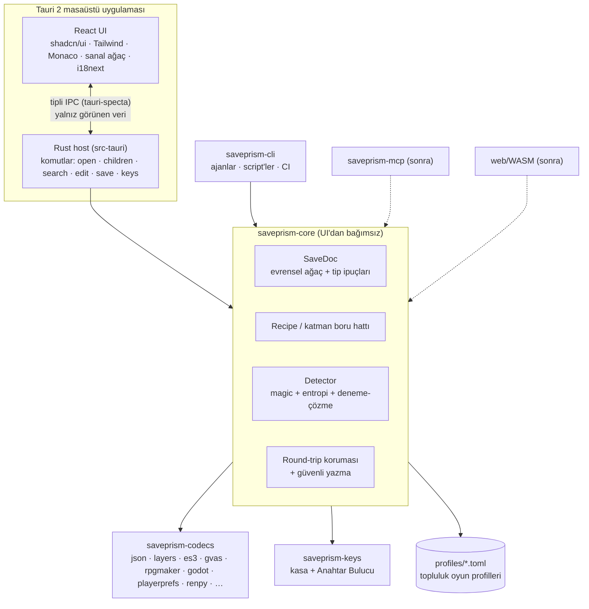

# Mimari

> **TL;DR:** Tauri 2 masaüstü kabuğu + Rust çekirdek (`saveprism-core`) + React/TypeScript arayüz. Belge Rust'ta yaşar; arayüz yalnız görünen kısmı ister (tembel ağaç). Aynı çekirdek CLI'ı, ileride MCP sunucusunu ve web (WASM) sürümünü besler.
>
> **Sonraki adım:** [kararlar.md](kararlar.md) ADR-001…003'ü onayla.

> Ad: **SavePrism** (ADR-011).

---

## 1. Teknoloji yığını

| Katman | Seçim | Neden |
|---|---|---|
| Kabuk | **Tauri 2** | ~10 MB kurulum, Rust çekirdeği doğrudan kullanır, yetki (capability) modeli, resmi updater eklentisi |
| Çekirdek | **Rust workspace** | Güvenilmeyen ikili veri için bellek güvenliği, büyük kayıtlarda hız, `uesave` yerel, CLI/MCP/WASM için tek kod |
| UI | **React 19 + TypeScript + Vite** | shadcn ekosistemi React-öncelikli; RPGSaveEditor (React) ile fikir/kod alışverişi |
| Bileşenler | **shadcn/ui** (Radix veya Base UI) + **Tailwind v4** | Kod bizim repomuzda yaşar, temalanabilir, erişilebilir |
| Ağaç / tablo | **TanStack Virtual + TanStack Table**, özel tembel ağaç | Milyonlarca düğümde akıcı kaydırma |
| Ham görünüm | **Monaco Editor** | JSON şema doğrulama, büyük metin |
| Durum | Zustand | Küçük ve yeterli |
| Komut paleti | cmdk | Ctrl+K |
| i18n | i18next + ICU mesajları | Topluluk çevirisi (Weblate) |
| IPC tipleri | tauri-specta 🔎 | Rust → TS tip üretimi; elle senkron yok |
| Paket yöneticisi | pnpm (sende 11.x) | Hızlı, workspace desteği |

### Neden Python sidecar değil, neden Electron değil

- **Python sidecar:** PyInstaller paketleri 30–80 MB, yavaş açılış, antivirüs yanlış pozitifleri, ikinci çalışma zamanı. Python yalnız **araştırma script'leri** için (palworld-save-tools, fickling ile çapraz doğrulama).
- **Electron:** ~100 MB+ kurulum; Rust çekirdeğini yine N-API ile bağlamak gerekirdi.
- **Bedel (Tauri):** platforma göre WebView farkı (Windows WebView2, macOS WKWebView, Linux WebKitGTK) → Linux ayrıca test edilir.

---

## 2. Bileşen şeması



---

## 3. Çekirdek kavramlar

### 3.1 Katman boru hattı (Recipe)

Kayıt = katman yığını. Her katman `decode` ederken geri sarmak için gereken parametreleri kaydeder.

```toml
# ES3 örneği — otomatik tespit edilir veya UI'da elle kurulur
[[layer]]
kind = "crypto.es3-aes"
salt = "base64:…"            # orijinal salt korunur
iterations = 100
key_ref = "vault:example-game"

[[layer]]
kind = "compression.gzip"
level = 6                     # orijinal başlık/seviye korunur

[[layer]]
kind = "format.es3-json"
```

- Tarif serileştirilebilir → paylaşılabilir, AI okuyabilir, oyun profiline girer.
- Detector her adımda adayları güven puanıyla sıralar (magic → entropi → deneme-çözme → doğrulama) — CyberChef "Magic" mantığı.
- Bilinmeyen dosyada kullanıcı tarifi UI'da elle kurar (ör. Base64 → XOR(anahtar) → JSON) ve profile kaydeder.

### 3.2 SaveDoc (evrensel ağaç)

```rust
pub struct SaveDoc { nodes: Vec<Node>, root: NodeId }   // arena; NodeId(u32) = indeks, oturuma özel

pub enum Value {
    Null,
    Bool(bool),
    Int { v: i128, width: IntWidth },              // i8…u64 bilgisi korunur
    Float { v: f64, width: FloatWidth },
    Str(String),
    Bytes(Vec<u8>),
    Array(Vec<NodeId>),
    Object(Vec<(String, NodeId)>),                 // metin anahtar; sıra ve tekrar eden anahtar korunur
    Map(Vec<(NodeId, NodeId)>),                    // metin olmayan anahtar: GVAS MapProperty, pickle dict, Ruby Hash
    Ref(NodeId),                                   // JsonEx/pickle/Marshal referansları
}

pub struct Node {
    pub value: Value,
    pub type_hint: Option<TypeHint>,  // "UE:IntProperty", "Py:int", "Ruby:Fixnum", "ES3:int", "JSON:float"
    pub lexeme: Option<Box<str>>,     // skalerin orijinal metni, codec'in kanonik yazımından farklıysa ("1.0", "é")
    pub span: Option<ByteSpan>,       // kayıpsız yama için orijinal bayt aralığı
    pub flags: NodeFlags,             // Editable | ReadOnly | Synthetic
}
```

- `type_hint` → UI doğru editörü gösterir; AI dönüşünde tip ihlali yakalanır. Düzenlenen `1.0` → `2` olursa `JSON:float` ipucu `2.0` yazdırır.
- `lexeme` → metin formatlarında bayt-kesin geri yazım. Değer düzenlenince `SaveDoc` onu siler; codec'ler yalnız `lexeme` varsa onu basar.
- `span` → kayıpsız yama.
- Düzenlemeler (`Edit`) düğümü `Path` ile (`/actors/1/gold` gibi) adresler, `NodeId` ile değil: AI yamaları ve geri al/yinele oturumdan bağımsız kalır.

### 3.3 Codec sözleşmesi

İki tür adım var: **katman** (bayt ↔ bayt: kodlama, sıkıştırma, şifre) ve **codec** (bayt ↔ SaveDoc, tarifin son adımı).

```rust
pub trait Layer: Send + Sync {          // "encoding.base64", "compression.gzip", "crypto.es3-aes"
    fn id(&self) -> &'static str;
    fn sniff(&self, input: &[u8], ctx: &SniffCtx) -> Confidence;
    fn decode(&self, input: &[u8], ctx: &mut DecodeCtx) -> Result<(Vec<u8>, Params)>; // iç bayt + geri sarma parametreleri
    fn encode(&self, inner: &[u8], params: &Params) -> Result<Vec<u8>>;
}

pub trait Codec: Send + Sync {          // "format.json", "format.gvas"
    fn id(&self) -> &'static str;
    fn sniff(&self, input: &[u8], ctx: &SniffCtx) -> Confidence;
    fn decode(&self, input: &[u8], ctx: &mut DecodeCtx) -> Result<Decoded>; // SaveDoc + Params
    fn encode(&self, doc: &SaveDoc, params: &Params) -> Result<Vec<u8>>;    // tam yeniden yazım
    fn patch(&self, original: &[u8], edits: &[Edit], params: &Params) -> Result<Vec<u8>> {
        // varsayılan: decode + düzenlemeleri uygula + encode
    }
}
```

- `Recipe` = adım listesi: baştakiler `Layer`, sonuncusu `Codec`. `Registry` kimlikten uygulamaya eşler; `saveprism-codecs` hepsini
  `register_all(&mut Registry)` ile kaydeder. Boru hattı (`pipeline`) tarifi `Limits` ile koşar; her adım hataya bağlam ekler.
- `Params` = sıralı anahtar → değer (bool, tamsayı, ondalık, metin, bayt, liste, tablo). TOML'da baytlar `"base64:…"` metnidir.
- `DecodeCtx` sınırları (`Limits`) taşır: girdi boyutu, çözülmüş boyut, sıkıştırma oranı, derinlik, düğüm sayısı, katman sayısı.

İki yazma stratejisi:

1. **Yeniden yazım** — basit formatlar (JSON, GVAS/uesave, ES3).
2. **Kayıpsız yama** — karmaşık formatlar (pickle, Marshal, NRBF): dokunulmayan her bayt aynen kalır.

### 3.4 Round-trip koruması (güven özelliği)

Açılışta, düzenleme açılmadan önce: `decode → encode` (değişikliksiz) == orijinal bayt mı?

| Sonuç | Davranış |
|---|---|
| Birebir aynı | Düzenleme açık |
| Anlamsal eşit (ör. JSON boşlukları) | "Biçim farkı" uyarısıyla açık |
| Farklı | Salt-okunur + "Bu dosya henüz güvenle yazılamıyor — örnek dosyayı issue'ya ekle" |

Kaydettikten sonra: yazılan dosya yeniden çözülür ve düzenlenen değerler doğrulanır.

Katmanlı dosyada her adım ayrı ölçülür, en kötü sonuç geçerlidir. Örnek: GZip'i başka bir sıkıştırıcı yazmışsa açılmış içerik
aynı ama sıkıştırılmış baytlar farklıdır → "Anlamsal eşit". Katman, orijinal seviyeyi deneyerek bulursa (seviye 0–9) → "Birebir aynı".
JSON'da düzenli girinti (makine çıktısı) birebir geri yazılır; elle bozulmuş girinti → "Anlamsal eşit".

### 3.5 Güvenli yazma

1. **Yedek:** uygulama veri dizinine (`%APPDATA%\SavePrism\backups\<yol-özeti>\<zaman>.bak`), son 10 yedek halkası. Yedek **kayıt klasörüne konmaz** — bazı oyunlar klasördeki her dosyayı kayıt sanar.
2. Geçici dosyaya yaz (hedefle aynı klasör, kısa ömürlü `.saveprism-*.tmp`) → `fsync` → atomik değiştir. M1: `tempfile` `persist`
   (Windows `MoveFileExW(REPLACE_EXISTING)`, Unix `rename` + klasör `fsync`). `ReplaceFileW` `unsafe` FFI ister → sonraya (ADR-016).
3. Doğrula (3.4). Başarısızsa yedekten geri al.
4. Yedek kökü çekirdekte tek fonksiyondadır (`default_backup_root`); CLI ve masaüstü aynı klasörü kullanır. Klasör adı yolun
   FNV-1a 64 özetidir (Rust sürümleri arasında kararlı).

### 3.6 Belge sahipliği ve IPC

- Belge Rust'ta yaşar. UI şu çağrıları yapar: `get_children(node, offset, limit)`, `search(query, page)`, `apply_edits(edits)`, `undo/redo`, `export(subtree, format)`, `save()`.
- Arama Rust'ta paralel (rayon), sonuçlar sayfalı.
- Hedef: 200 MB çözülmüş belge akıcı açılır ve kayar (🔎 M2-8 benchmark ile ölçülür).

### 3.7 AI köprüsü

1. **AI için kopyala:** seçili alt ağaç → temiz JSON (opsiyonel `$type` ipuçları), JSONPath bilgisi, tahmini token sayısı, hazır komut şablonu: *"Yalnız değerleri değiştir; anahtarları ve yapıyı koru; RFC 6902 JSON Patch döndür."*
2. **AI'dan içe aktar:** tam JSON veya JSON Patch → fark önizlemesi → tip denetimi (`type_hint`) → uygula (geri alınabilir).
3. **CLI:** `saveprism inspect | decode | encode | patch | keys` — kararlı JSON şemalı çıktılar; ajanlar ve script'ler için.
4. **MCP (sonra):** aynı çekirdek; araçlar `open_save`, `query`, `apply_patch`, `save`, `get_last_diagnostic`. Yazma her zaman kullanıcı onaylı.
5. **Hata anında:** Teşhis Raporu (3.8) aynı köprüyü kullanır — kopyala, AI'a sor, önerilen tarifi doğrula.

### 3.8 Teşhis Raporu (XMCL'den ilham)

Bir şey ters gittiğinde kullanıcı "neden?" sorusunun cevabını tek ekranda görür, kopyalar ya da bir AI'a sorar.

**Tetikleyiciler**
1. Dosya tanınmadı (Detector güven puanı eşiğin altında)
2. Şifre/anahtar doğrulaması başarısız
3. Round-trip eşleşmedi (dosya salt-okunur açıldı)
4. Codec hatası veya uygulama çöküşü (Rust panic hook + React ErrorBoundary)

**İçerik** (Markdown + makine okunur JSON, ikisi aynı veriden)

| Bölüm | Ne var |
|---|---|
| Ortam | Uygulama sürümü, işletim sistemi, WebView sürümü |
| Dosya | Ad (maskeli), boyut, uzantı, ilk 64 bayt hex, entropi |
| Tespit izi | Denenen her katman: güven puanı, reddedilme nedeni |
| Hata zinciri | Hata + nedenler (Rust `Error` source zinciri) |
| Log | Son 200 satır (`tauri-plugin-log`) |

- Kayıt **içeriği varsayılan olarak girmez**; kullanıcı isterse alt ağaç ekler.
- Maskeleme otomatik: `C:\Users\<ad>` → `%USERPROFILE%`, Steam ID, e-posta, makine adı.
- Gönderilmeden önce önizleme; hiçbir şey otomatik gönderilmez, ağ çağrısı yok.

**Eylemler**
1. **Kopyala** — Markdown olarak panoya.
2. **AI'a sor** — üç seviye:
   - Seviye 1: rapor + hazır soru panoya kopyalanır, kullanıcı istediği sohbeti açar (kurulum yok).
   - Seviye 2: bağlı ajan — MCP aracı `get_last_diagnostic` ile Claude Code raporu kendisi okur (M8).
   - Seviye 3: kullanıcının kendi API anahtarı (isteğe bağlı, her gönderimde onay).
3. **Önerilen tarifi dene** — AI cevabındaki tarif bloğu (ör. `["encoding.base64", "compression.zlib", "format.json"]`) ayrıştırılır, diske yazmadan bellekte denenir, round-trip testinden geçerse "işe yaradı ✓" + profile kaydet.
4. **GitHub issue'su aç** — "format isteği" şablonu açılır; rapor kullanıcı tarafından panodan yapıştırılır (URL'ye veri konmaz).

**Farkımız:** XMCL logu gösterip AI'a sorduruyor; biz ayrıca AI'ın önerisini makinede **doğruluyoruz**.

### 3.9 Anahtar kasası ve Anahtar Bulucu

- **Kasa:** yerel `keys.toml` — oyun → motor → anahtar → kanıt (dosya, yöntem, tarih).
- **Bulucu:** motor tespiti → aday üretimi (Mono: `#US` user strings; IL2CPP: string literal; Godot: GDScript) → aday doğrulama (ES3: PBKDF2 + AES + düz metin sezgisi) → kasaya yaz.
- Topluluk profilleri başlangıçta anahtarı değil **bulma yöntemini** taşır (ADR-009).

### 3.10 Motor tespiti ve kayıt bulucu

| İz (oyun klasöründe) | Motor |
|---|---|
| `UnityPlayer.dll` + `*_Data/Managed/` | Unity Mono |
| `GameAssembly.dll` + `global-metadata.dat` | Unity IL2CPP |
| `*.pak` + `Engine/` | Unreal |
| `*.pck` veya exe'ye gömülü PCK | Godot |
| `www/js/rpg_core.js` / `js/rmmz_core.js` | RPG Maker MV / MZ |
| `Game.rgss*a` / `RPG_RT.exe` | RPG Maker XP–VXA / 2000–2003 |
| `renpy/` + `game/` | Ren'Py |
| `data.win` | GameMaker |

Varsayılan kayıt yolları: `%LOCALAPPDATA%\<Oyun>\Saved\SaveGames` (UE) · `%USERPROFILE%\AppData\LocalLow\<Şirket>\<Ürün>` (Unity) · `%APPDATA%\RenPy\…` ve `game/saves` (Ren'Py) · `%APPDATA%\Godot\app_userdata\<Proje>` (Godot).

### 3.11 Oyun profilleri (topluluk eklentisi = veri)

```toml
[game]
id = "example-game"
name = "Example Game"
engine = "unity-es3"

[save]
paths = ["%USERPROFILE%/AppData/LocalLow/Studio/Example/SaveFile.es3"]
recipe = ["crypto.es3-aes", "compression.gzip", "format.es3-json"]
key = { method = "dotnet-user-strings", assembly = "Assembly-CSharp.dll" }

[[quick]]
path = "$.gold.value"
label = { tr = "Altın", en = "Gold" }
```

- Codec = Rust kodu (derleme zamanı, çekirdek ekip). Profil = veri (PR ile herkes).
- İleride WASM codec eklentileri (Extism/wasmtime) → Park alanında.

---

## 4. Arayüz

```
┌ Başlık: dosya adı · motor rozeti · tarif zinciri ······ [AI] [Kaydet] ┐
│ Kenar çubuğu │ Ağaç │ Tablo │ Ham │ Hex │ Fark            │ Denetçi   │
│ Son dosyalar │ sanal ağaç, değişen düğümler vurgulu     │ yol, tip, │
│ Oyunlar      │                                            │ ham bayt  │
└ Durum çubuğu: 3 değişiklik · round-trip ✓ · son yedek 14:02 ─────────┘
```

1. **Arama sözdizimi:** metin, regex, sayı (`>1000`, `100..200`), yol (`party.**.gold`) — RPGSaveEditor'den ilham.
2. **Değeri bul:** iki veya daha fazla kaydı karşılaştır → değişen / artan / azalan.
3. **Düzenleme akışı:** geri al/yinele, bekleyen değişiklikler paneli, Ctrl+K palet, sürükle-bırak.
4. **Tema:** açık / koyu / sistem + CSS değişkeni token'larıyla özel tema JSON'u.
5. **i18n ve erişilebilirlik:** ilk günden TR + EN (`locales/<dil>/*.json`, Weblate); Radix/Base UI ilkelleri, tam klavye kullanımı.

---

## 5. Hedef repo yapısı

```
saveprism/
├─ crates/
│  ├─ saveprism-core/      # SaveDoc, Codec, Recipe, Detector, patch, round-trip, güvenli yazma
│  ├─ saveprism-codecs/    # json, layers, es3, gvas, rpgmaker, godot, playerprefs, renpy, …
│  ├─ saveprism-keys/      # kasa + Anahtar Bulucu
│  └─ saveprism-cli/       # `saveprism` komutu
├─ apps/desktop/
│  ├─ src/                # React UI
│  ├─ locales/            # i18n
│  └─ src-tauri/          # Tauri host (komutlar → core)
├─ profiles/              # oyun profilleri (TOML)
├─ fixtures/
│  ├─ samples/            # izinli örnek kayıtlar (bayt-kesin; ajanlara kilitli)
│  ├─ synthetic/          # elle/araçla üretilmiş metin örnekleri (ajanlar yazabilir)
│  └─ expected/           # beklenen tarif ve round-trip sonucu (<motor>/<ad>.toml)
├─ fuzz/                  # cargo-fuzz hedefleri (workspace dışı, gecelik araç zinciri)
├─ docs/
└─ .github/               # CI, şablonlar
```

---

## 6. Kalite ve güvenlik

1. **Altın round-trip testleri** her codec için (fixture → decode → encode == bayt).
2. **proptest** (özellik testleri) + **cargo-fuzz** (ayrıştırıcı bulanık testi). Sınırlar: maksimum boyut, derinlik, sıkıştırma oranı (bomba koruması). Panik yok.
3. **Kod çalıştırma yok:** pickle, Ruby Marshal, BinaryFormatter yalnız ağaca çözülür.
4. **Tedarik zinciri:** cargo-deny (lisans + advisory), osv-scanner, CodeQL, Dependabot/Renovate, OpenSSF Scorecard.
5. **Fixture politikası:** yalnız katkıcının kendi ürettiği/izin verdiği kayıtlar; kişisel veri (kullanıcı adı, Steam ID) temizlenir.

---

## 7. Dağıtım

| İş | Araç |
|---|---|
| Sürüm + CHANGELOG | release-please (Conventional Commits) |
| Derleme matrisi | `tauri-apps/tauri-action` — Windows (NSIS `.exe` + `.msi`), macOS (universal `.dmg`), Ubuntu (AppImage, `.deb`, `.rpm`) |
| Otomatik güncelleme | `tauri-plugin-updater`; GitHub Releases'taki `latest.json` + imza (minisign özel anahtarı GitHub Secrets'ta) |
| Kanallar | stable + beta (pre-release) |
| Windows kod imzası | SignPath Foundation (açık kaynağa ücretsiz) — ilk public sürümden sonra başvuru; o zamana dek SmartScreen uyarısı README'de açıklanır |
| macOS imza/notarization | Apple Developer hesabı ($99/yıl) gerekir → ADR-012; yoksa "Sağ tık → Aç" talimatı |
| Paket yöneticileri (sonra) | winget, Scoop, Homebrew cask, Flathub |

---

## 8. Public öncesi topluluk kontrol listesi

LICENSE (MIT) · README (EN + TR) · CONTRIBUTING · CODE_OF_CONDUCT (Contributor Covenant) · SECURITY.md · DISCLAIMER.md (sorumlu kullanım) · THIRD_PARTY_NOTICES (cargo-about + pnpm licenses) · issue şablonları (hata, format isteği, oyun profili) · PR şablonu · Discussions · etiketler (`good first issue`, `format:*`, `engine:*`, `later`).
